# Desk Buddy v3.15

ESP32-C3 + SH1106 OLED + TTP223 touch + tilt switch + passive buzzer.

## Wiring and GPIO pinout
The default wiring the firmware ships with. All of it lives in **include/config.h** (`PIN_*`) -
change the numbers there to match your wiring and everything follows.

| Buddy signal | GPIO | Connect it to |
| --- | --- | --- |
| `PIN_OLED_SDA` | **4** | SH1106 OLED **SDA** (I2C data) |
| `PIN_OLED_SCL` | **5** | SH1106 OLED **SCL** (I2C clock) |
| `PIN_TOUCH` | **1** | TTP223 touch pad **OUT** (HIGH = touched) |
| `PIN_TILT` | **3** | tilt switch, other leg to **GND** |
| `PIN_BUZZER` | **2** | passive buzzer **+** (LEDC PWM tone) |

- Power the OLED, the TTP223 and the buzzer from the board's **3V3** and **GND** rails. Everything
  is 3.3 V logic - never feed 5 V into a signal pin.
- The OLED talks on hardware I2C at address **0x3C** (the usual SH1106 module default); most
  modules already carry the pull-up resistors.
- The TTP223 should be in its default **momentary** mode (A/B jumper open). If yours is soldered
  to TOGGLE/latching mode, set `TOUCH_TOGGLE_MODE 1` in config.h.
- The tilt switch is read with the internal pull-up: one leg to **GPIO 3**, the other to **GND** -
  polarity of the switch itself does not matter.
- After a clone, create `include/wifi_credentials.h` with your WiFi name/password (it is
  git-ignored so it never leaves your machine - see section 1).

## 1. Your WiFi
Your WiFi name, password and the OTA password live in **include/wifi_credentials.h** - that file is
in `.gitignore`, so it is never committed to GitHub. Open it and set the three lines (the build
refuses to run until you do):

    #define WIFI_SSID           "YourWiFiName"
    #define WIFI_PASS           "YourWiFiPassword"
    #define OTA_PASSWORD        "ChangeMe"

Build and upload. There is no hotspot; the buddy joins your WiFi (2.4 GHz only). Watch the Serial Monitor
(115200): `[WIFI] connected. Web app: http://192.168.x.x`. The address is also in Menu -> Info.
The radio runs at reduced TX power (WIFI_TX_POWER) which is what makes many ESP32-C3 boards connect.
WiFi **tuning** (TX power, retry interval, mDNS name) stays in `include/config.h` - nothing secret there.
Do not rename the file to `wifi.h`: on Windows that name collides with the ESP32 library's own
`<WiFi.h>` and the build breaks (see FIX_NOTES v3.14).

### Updating over WiFi (OTA) - the cable goes in the drawer
From v3.15 on, the buddy can be reflashed over WiFi. One last USB flash is needed **once**, now:
this version changes the flash layout from one big app slot to two ~1.9 MB slots (`min_spiffs.csv`),
and a partition change can only be written over USB. So: `pio run -t upload` with the cable, one
last time. Settings, alarms and tasks live in a different region (NVS) and survive it.

After that, everything goes over the air:

- **The easy way** - `tools\ota_update.bat` (double-click or from a terminal). It builds the
  firmware, then flashes `deskbuddy.local` wirelessly. Different buddy or `.local` not resolving?
  `tools\ota_update.bat 192.168.1.42` with the IP from Menu -> Info. The script reads the OTA
  password from `include/wifi_credentials.h` - nothing secret ever gets committed.
- **The manual way** - same thing by hand:

      pio run
      python %USERPROFILE%\.platformio\packages\framework-arduinoespressif32\tools\espota.py ^
        --debug --progress -i deskbuddy.local --auth=YOUR_OTA_PASSWORD ^
        -f .pio\build\esp32c3\firmware.bin

- **From any browser, phone included** - open `http://deskbuddy.local:8080` (user `deskbuddy`,
  password = `OTA_PASSWORD`) and upload `.pio\build\esp32c3\firmware.bin`. Android phones cannot
  resolve `.local` names - use the IP there.

What to expect: the buddy freezes and stops answering its web app for the minute the upload takes,
then reboots itself into the new firmware. A failed or interrupted upload changes nothing - the new
image is only activated after it arrived complete. The upload only starts with the right password
(both doors, network and browser, ask for it). If uploads keep timing out, the buddy may be too far
from the router: raise `WIFI_TX_POWER` in `config.h` (e.g. `WIFI_POWER_19_5dBm`), flash once more,
and lower it again if you want. The Serial Monitor only works while USB is attached - that is the
one thing you lose by going wireless.

Upgrading from v3.14? Add one line to `include/wifi_credentials.h` (the OTA password):

    #define OTA_PASSWORD        "YourChosenPassword"

then flash over USB one last time (`pio run -t upload`) - this version changes the flash layout
to two OTA slots, and that needs the cable (see "Updating over WiFi" above). After this, updates
go over the air. From v3.13, **rename** `include/wifi.h` to `include/wifi_credentials.h` (a file
named `wifi.h` in `include/` breaks the build on Windows). From v3.12, take the credentials out of
`include/secrets.h` and delete that file; from v3.11 or earlier, out of `include/config.h`.
Then build and upload and hard-refresh the web app (Ctrl+Shift+R). Settings, alarms and tasks are
kept. Coming from v3.8? Also check `PIN_*` still match your wiring.

## 2. Touching your buddy
| What you do | What happens |
|---|---|
| **Scratch / stroke its head** (touch longer than 0.45 s, or 4+ rapid touches) | **Petting**: eyes close in relief, head leans into your hand, blush, a soft murmur every few seconds. Keep going: deeper bliss, then heart eyes + a coo. Stop: pleased afterglow face |
| **Tap** | boop reaction (in widget mode: next widget) |
| **Double tap** | widget screens on / off |
| **Triple tap** | menu (in the menu: tap = next, hold = select) |

Petting can never trigger the menu or widgets by accident. Each mood reacts differently:
grumpy sulks first (tsundere), active gets ticklish, romantic gets shy then adoring, sleepy dozes off.

### Tilt switch: picking it up, tipping it, rocking it
The tilt switch is debounced (a ball switch rattles) and read as a *state*: how long it has been tipped,
when it was set back down, and how often it flips. Each mood has its own reactions (tables in `src/app.cpp`,
timings in `include/config.h`):

| What you do | Balanced mood | (others differ: grumpy snaps, romantic gets shy, sleepy yawns...) |
|---|---|---|
| Tip it for 0.4 s | confused | |
| ...hold it 2.5 s | dizzy | |
| ...hold it 8 s | sad | |
| ...hold it 20 s | cries | |
| Set it back after 2.5 s+ | "phew" happy | |
| Rock it gently back and forth | giggles (a cradle) | keep going and it gets dizzy |
| Shake it | surprised -> dizzy -> angry -> crying (unchanged) | |
| Pick it up and hold while it sleeps | wakes up (not during do-not-disturb) | |

Touch, a menu, a ringing alarm or a shake always take priority over tilt reactions. If it is left tipped for
90 s it simply learns that as its new "upright" (and a wrongly-oriented boot corrects itself).
Menu -> Sensors shows how long it has been tipped.

## 3. Widget screens (double tap)
The eyes stay on top of every screen. Tap to scroll: **Clock** -> **Weather** -> **Date** -> **Tasks** -> **Up next**.
Turn widgets on/off, pick **12 hour (AM/PM, default) / 24 hour**, set the **weather location** and
temperature unit in the web app (Settings -> Clock & weather). The location search is area-wise:
it finds suburbs, neighbourhoods, villages and localities (via OpenStreetMap) as well as plain
cities, so "HSR Layout" or "Koramangala, Bengaluru" pinpoints weather for that exact area.
Weather comes from Open-Meteo (free, no key), refreshed every 30 minutes.

The **Tasks** screen shows today's checklist: a `done/total` counter, checkboxes, and each task's optional
time. If today is empty it jumps ahead to the next day that has something (up to two weeks out).
To browse any particular day on the device, use Menu -> Tasks: **tap = next day, hold = back**.

## 4. Planner: alarms, reminders and tasks (web app)
The web app's **Planner** tab is a small calendar:

- **Calendar view** - a month grid. Teal dots are tasks (dim when done), blue dots are alarms/reminders.
  Tap a day to open it: its tasks (tick them off right there), everything that rings that day, and
  **+ Task / + Reminder / + Alarm** buttons that pre-fill the date.
- **List view** - the classic alarm/reminder list, plus your tasks grouped at the bottom.
  Filter chips: All / Alarms / Reminders / Tasks.

**Tasks** are the quiet kind of reminder: no time needed, no ringing. Give one a day, optionally let it
**run over several days** (a trip, a deadline week) and optionally pin a time to it - the time is only
used for ordering, it never rings. Checking a task off keeps it (struck through) until you delete it.
**Reminders** (slide-in notification + ring) and **alarms** (full-screen ring) work exactly as before.

Everything is stored on the device (NVS, 32 alarms + 32 tasks) and survives reboots and power cuts.
Dates are checked (no 30 February), and labels/titles are plain ASCII because the OLED fonts have no other glyphs.

**Alarm behaviour:** alarms that share a minute, or fall due while another is ringing, wait in line instead of
being lost. An alarm nobody answers stops after 2 min (1 min for a reminder), snoozes, and gives up after two
rounds. A one-time alarm that came due during a power cut (up to 30 min late) rings once the clock is back.
Daily/weekly alarms missed while the buddy was off are *not* replayed (it cannot know if you already dismissed them).

## 5. Faces
41 expressions in 6 eye styles x 7 moods, incl. the whole reference sheet: heart eyes (love, anime love),
flame eyes (fire), `> <` crying, paw eyes (cute), kiss `3`, `^w^` mini love, serious, sleepy zzz + drool, tongue-out blep...
Small mouths where an expression needs one. Edit everything in `tools/gen_faces.py`, then run
`python3 tools/gen_faces.py`.

### The full expression sheet
Every one of the 41 expressions, in menu order. The thumbnails are rendered with the exact code that
drives the OLED - the JS twin in `src/webface.cpp` that the web app uses for its live mirror - so each
image is pixel-for-pixel what the buddy shows on its screen:

|  |  |  |  |
|---|---|---|---|
|  **neutral** |  **happy** | 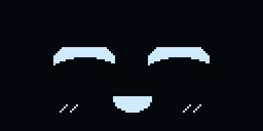 **laugh** |  **love** |
| 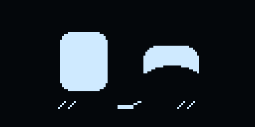 **wink** | 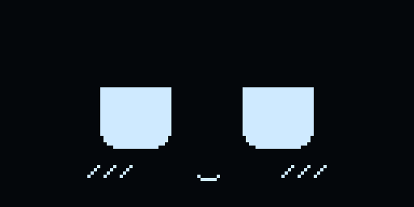 **shy** | 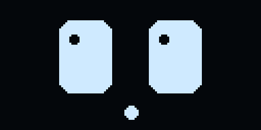 **surprised** |  **angry** |
|  **sad** |  **cry** |  **sleepy** | 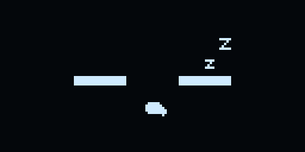 **sleep** |
|  **focus** |  **chill** | 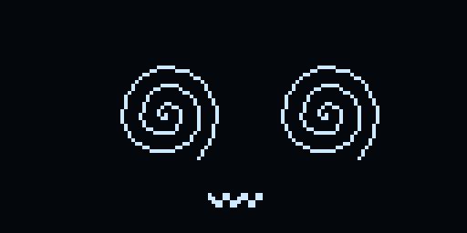 **dizzy** |  **bored** |
| 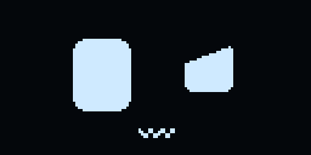 **confused** |  **panic** |  **smug** |  **sus** |
|  **party** |  **thinking** |  **wow** |  **dead** |
|  **serious** | 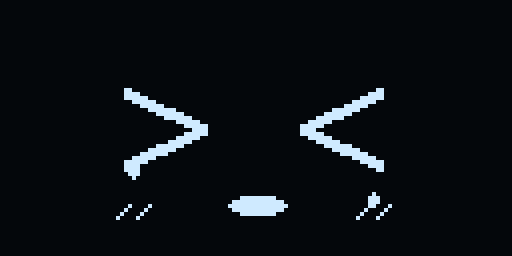 **bawl** | 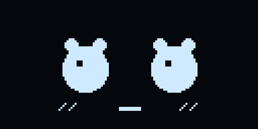 **cute** | 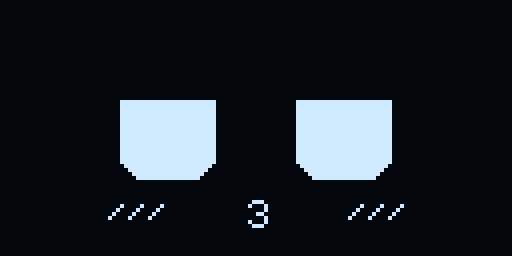 **kiss** |
|  **minilove** |  **animelove** |  **fire** | 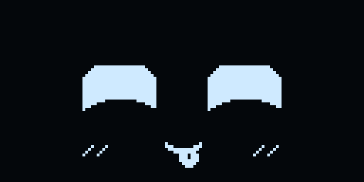 **blep** |
|  **yawn** |  **bliss** |  **giggle** | 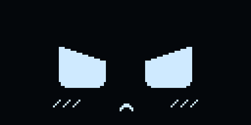 **pout** |
| 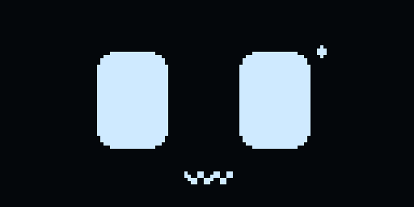 **nervous** | 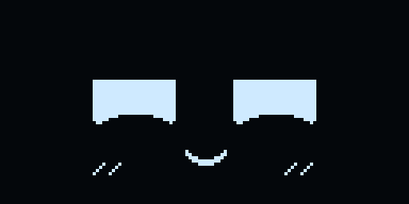 **dreamy** |  **mischief** |  **xd** |
|  **whistle** |  |  |  |

### Eye styles (web app -> Settings -> Eye style)
One expression ("happy") in all six eye styles - a style re-draws every face in its own shape
language, from round orbs to cat eyes:

|  |  |  |  |  |  |
|---|---|---|---|---|---|
|  **boxy Rounded rectangles** |  **orb Soft round orbs** |  **morph Rect that turns round** |  **pixel Chunky retro pixels** |  **sleek Thin robot visor** |  **cat Cat eyes, slit pupils** |

## 6. Sounds
A pet, not a buzzer. Every note swells in and fades out (soft envelopes, no harsh edges), the personality
speaks at low volume while alarms and the cuckoo stay loud, and only the expressive faces have a voice at
all - most face changes are silent, so it never chatters. Petting gets a soft contented murmur every few
seconds, never a continuous purr. Voices are short phrases in the warm C-major pentatonic range
(262-880 Hz, away from the buzzy 2-3 kHz region). Shake it -> surprised, dizzy, angry, crying.
Cuckoo every hour 07:00-23:00 (12-hour count). Emotion sounds are muted 23:00-07:00, in the silent mood
and while do-not-disturb is on. **Alarms and reminders always sound** - even with Sound set to off they ring at a
medium level, so you cannot oversleep. The study-timer sounds follow the volume setting. Tasks stay silent - they
are checklist items. Everything is editable in `src/audio.cpp` (voices, murmurs, volume tiers).

## 7. Do not disturb (web app -> Settings)
Pick a daily quiet window (default **8 PM - 6 AM**, it can wrap midnight). While it is active:

- the buddy is **silent**: no emotion sounds, no murmurs, no cuckoo. **Alarms and reminders still ring**
  exactly as if nothing changed, and the study timer still sings at the end of a session.
- on the **home face only** (never in widgets, the menu or while a timer runs): untouched for
  **15 min** it drifts to its sleeping face, at **30 min** the screen goes dark. Any touch wakes it,
  and the count starts over. After an alarm rings in the night the same 15/30 min cycle begins again.
- when the window ends (or you switch DND off) the buddy **wakes up by itself**. A sleep you started
  yourself from the menu is left alone.

The web app's home screen shows a small "do not disturb" note under the display while the window is on.
The 15/30 minute timings live in `include/config.h` (`DND_IDLE_SLEEP_MS`, `DND_IDLE_DEEP_MS`).

## 8. Study timer, alarms, reminders
Focus session: study glasses drop on, serious face; break: glasses off. Alarms ring full-screen;
reminders slide in from the top like a phone notification and ring until you tap once.
Starting a session from the web app brings the buddy to its face screen whatever it was showing
(widgets, menu or a dark panel) - only a ringing alarm keeps the screen.
All managed in the web app (Planner tab); the next ones are also on the device: Menu -> Up next, and the Up next widget.

## 9. Time
IST, synced from NPL / NIC India time servers (global pool only as a fallback).

## 10. Display care
After 3 minutes with no touch, tilt, shake or alarm the panel dims to 30 % of your brightness (min 40/255) and
comes back on any interaction (`OLED_DIM_AFTER_MS`, `OLED_DIM_PERCENT` in config.h).

## 11. Hacking on it
`tools/webui.html` is the web app's source; after editing it run `python3 tools/gen_webui.py` to regenerate
`src/webui.cpp`. Faces are generated the same way (`tools/gen_faces.py`). Tasks live in `src/tasks.cpp`
(storage + day logic), the device widgets in `src/widgets.cpp`, the planner UI inside `tools/webui.html`.

## Troubleshooting
**Touch pad set to TOGGLE (latching) mode?** Set `TOUCH_TOGGLE_MODE 1` in config.h. (Auto-detecting it from a long
press was removed in v3.9 because a hand resting on the buddy could trigger it by mistake.)

PlatformIO "TypeError ... NoneType" before any compiling = a failed framework download. Delete
`.pio`, `%USERPROFILE%\.platformio\platforms\espressif32@src-*` and `...\packages\framework-arduinoespressif32*`,
keep `platform = espressif32@8.0.0` and build again on a stable connection.
